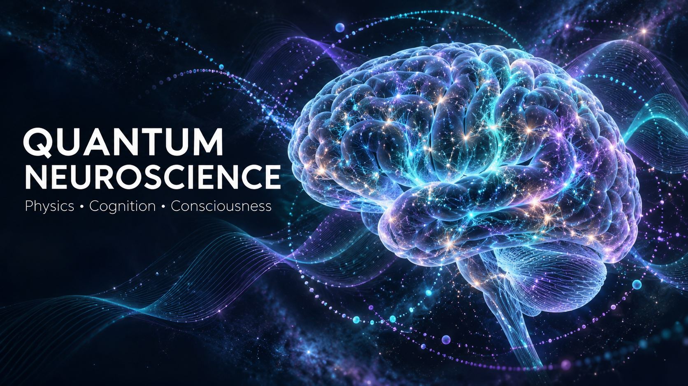

<p align="center">
  
</p>

# SYNAPSE-OS

Deterministic 1,000 Hz zero-copy neural telemetry and dynamical phase-space visualization engine for next-generation Brain-Computer Interfaces (BCIs) and neurostimulation hardware.

## Architecture & Specifications

* **Footprint:** Embedded edge memory footprint under 50 MB.
* **Latency Profile:** Sub-500 microsecond transit jitter across 16+ channels at 1,000 Hz.
* **Signal Pipeline:** Real-time cascaded biquad IIR filtering with bounded gain and zero impulse blowup.
* **Visualization:** Dual-canvas HTML5/Canvas2D oscilloscope streaming raw calibrated time series alongside real-time phase-space attractors (x vs dx/dt) at 60 FPS without UI thread locking.
* **Dynamical Modeling:** Native 4th-order Yoshida symplectic integrator preserving Hamiltonian energy invariants.

## Clinical Planning & Control Surfaces

* **Deterministic Edge Telemetry HUD (`static/dashboard.html`):** 16-channel scrolling potential traces, live FFT band decomposition, and 60 FPS Kerr phase-space attractors.
* **3D Neural Cockpit & Simulation Workstation (`webapp/neuroforge_cockpit.html`):** Interactive WebGL / Three.js planning interface with dolichocephalic cranial meshes, 128-element hemispheric transducer array, MNI stereotaxic voxel targets (Brodmann 25, ALIC, Hippocampus), and real-time FDA / IEC 62304 bio-dosimetry watchdogs (Mechanical Index < 1.90, Thermal Delta < +0.50°C).
* **Master Release Archive (`webapp/neuroforge_master_release_archive.html`):** In-browser package inspector and ZIP exporter.

## Verification

Run the automated invariant test harness:

```bash
python3 -m unittest discover -s tests -p "test_*.py"
```

## Quick Start

1. Start the WebSocket telemetry daemon:
   ```bash
   python3 bridge/telemetry_daemon.py
   ```
2. Open `static/oscilloscope.html` in Safari or Chrome to stream calibrated telemetry.
